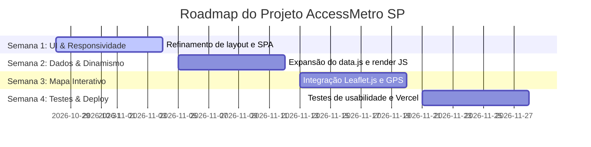

# 🚆 AccessMetro SP - Documentação do Projeto

O **AccessMetro SP** (também alinhado ao conceito do *Acesso+*) é uma aplicação web focada em **impacto social e acessibilidade urbana**. O objetivo principal do projeto é garantir autonomia e segurança na locomoção de pessoas com deficiência física ou mobilidade reduzida no sistema de metrô e trens de São Paulo.

---

## 🎯 1. Proposta de Valor e Impacto Social

Pessoas que dependem de elevadores, rampas e banheiros adaptados enfrentam imprevistos constantes no transporte público (elevadores quebrados, banheiros fechados ou atrasos sem aviso prévio). 

O **AccessMetro SP** resolve esse problema ao fornecer:
- **Transparência em Tempo Real:** Consulta prévia do status operacional de elevadores e banheiros acessíveis em cada estação.
- **Prevenção de Lotação:** Monitoramento do nível de lotação dos trens para evitar embarques em horários de pico críticos.
- **Autonomia de Deslocamento:** Informações detalhadas que permitem planejar trajetos de forma 100% independente, sem depender da ajuda de terceiros.

---

## 🏗️ 2. Arquitetura Técnica

O projeto foi concebido e codificado como uma **Single Page Application (SPA)** utilizando apenas tecnologias web fundamentais (**HTML5, CSS3 e JavaScript ES6+ puros**), sem dependência de frameworks externos como React.

### 📁 Estrutura de Pastas
```text
acessometro-sp/
├── index.html          # Estrutura principal e containers de telas (SPA)
├── DOCUMENTACAO.md     # Documentação do projeto
├── css/
│   └── style.css       # Estilos globais, variáveis, sistema responsivo (Mobile/Desktop)
└── js/
    ├── data.js         # Base de dados simulada (Linhas, estações, acessibilidade)
    └── script.js       # Lógica de navegação entre telas, rendering dinâmico e eventos
```

---

## 📱 3. Mapeamento das Telas do Aplicativo

1. **Tela 1: Linhas (Início)**
   - Lista das linhas monitoradas (Linha 1 - Azul, Linha 2 - Verde, Linha 5 - Lilás, Linha 9 - Esmeralda).
   - Indicadores visuais de lotação (barras de progresso e porcentagens).
   - Status operacional rápido (*Normal*, *Atrasado*, *Manutenção*).
   - Resumo de elevadores em funcionamento por linha.
   - Atalho para a versão Premium ("Sem Anúncios").

2. **Tela 2: Detalhes da Linha (Estações e Recursos)**
   - Lista detalhada de estações da linha selecionada.
   - Tags dinâmicas de acessibilidade em cada estação:
     - 🛗 **Elevador** (*Operacional / Manutenção*)
     - 🚻 **Banheiro Acessível**
     - ♿ **Acesso PCD / Rampas**
     - 🔊 **Anúncios Sonoros / Braille**
   - Abas internas de navegação: *Estações*, *Elevadores* e *Horários*.

3. **Tela 3: Mapa em Tempo Real**
   - Visualização cartográfica com filtros rápidos por linha.
   - Pins de localização indicando status das estações em tempo real.

4. **Tela 4: Guia de Acessibilidade (Legenda)**
   - Dicionário visual e glossário explicativo de todas as mídias e ícones do aplicativo.

5. **Tela 5: Assinatura Premium**
   - Simulação de planos (*Pro Monthly* e *Pro Yearly*) com os benefícios da versão sem anúncios e apoio ao projeto.

---

## 🗺️ 4. Estratégia do Mapa Interativo & GPS ("Como Chegar")

Para manter o projeto leve, rápido e funcional sem custos de API enterprise:

### 1. Mapa Interativo (Tela de Mapa)
- **Tecnologia:** Uso do **Leaflet.js** integrado ao **OpenStreetMap**.
- **Aplicação:** Desenho dos traçados das linhas e renderização de marcadores coloridos baseados na acessibilidade da estação (Verde = 100% Acessível; Vermelho = Elevador em manutenção).

### 2. Funcionalidade de GPS e Trajeto ("Como Chegar")
- **Integração Nativa:** Em vez de recriar um motor de rotas complexo, o botão **"Como Chegar (A pé)"** nos cards das estações utiliza a API nativa de geolocalização do navegador (`navigator.geolocation`) para abrir o Google Maps/Apple Maps do dispositivo do usuário pré-configurado na rota acessível a pé até a estação desejada.

---

## 📅 5. Roadmap de Desenvolvimento (Até 28 de Novembro)



- **Semana 1 (28/10 a 04/11):** Validação dos arquivos base (`index.html`, `style.css`, `data.js`, `script.js`), responsividade dinâmica para dispositivos móveis (`100dvh`) e sincronização no GitHub.
- **Semana 2 (05/11 a 12/11):** Expansão das estações reais de São Paulo no `data.js` e implementação dos filtros de status de manutenção.
- **Semana 3 (13/11 a 20/11):** Renderização do mapa interativo com **Leaflet.js** e inclusão do botão de rotas GPS "Como Chegar".
- **Semana 4 (21/11 a 28/11):** Testes de usabilidade focados em acessibilidade, ajustes de design, deploy contínuo na Vercel e preparação do pitch de apresentação.

---

## 🚀 6. Instruções de Publicação e Deploy

1. **Repositório GitHub:** `marianaarrudaavanco-ux/acesso-`
2. **Deploy via Vercel:**
   - Conectar conta da Vercel ao GitHub.
   - Importar o repositório `acesso-`.
   - Selecionar o preset **Other/Static**.
   - Executar **Deploy**.
